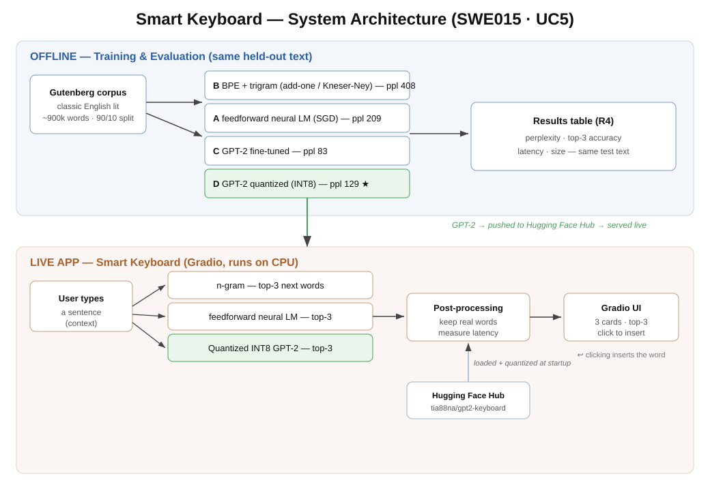

# ⌨️ Smart Keyboard — Next-Word Prediction


An on-device **next-word prediction keyboard** for English text. As you type, three
models suggest the top-3 next words **side by side**, each with its response time;
clicking a suggestion inserts it. The quantized Transformer powers the live app.

The same task is solved with **four language models of increasing sophistication** — a
classical n-gram, a feedforward neural LM, a fine-tuned GPT-2, and a quantized GPT-2 —
all evaluated on the **same held-out text** and compared on perplexity, accuracy, speed
and size.

> SWE015 — Introduction to Large Language Models · Use Case 5 (Smart Keyboard)

---

## ✨ Features

- **Live next-word prediction** as you type (Gradio).
- **Three models side by side**, each showing its top-3 suggestions.
- **Per-suggestion latency** shown for every model.
- **Click to insert** a suggestion into the text.
- Suggestions restricted to real corpus words for clean, in-domain output.

---

## 🧠 The model ladder (technique map)

| # | Model | Technique area | What it does |
|---|-------|:--------------:|--------------|
| 1 | n-gram (trigram) | **B** — Classical NLP | BPE tokenizer + add-one & Kneser-Ney smoothing |
| 2 | Feedforward neural LM | **A** — Deep learning | Embedding → hidden → softmax, trained with SGD |
| 3 | GPT-2 (fine-tuned) | **C** — Transformers | `gpt2` fine-tuned on the corpus |
| 4 | **GPT-2 INT8 (quantized)** | **D** — Efficient models | Conv1D→Linear + dynamic INT8 — **runs in the app** |

---

## 📊 Results

All models evaluated on the **same held-out text**, measured on CPU. Perplexity is
reported per word so the models are comparable (GPT-2's is normalized to per-word).

| Model | Perplexity | Top-3 accuracy | Latency | Size |
|-------|:----------:|:--------------:|:-------:|:----:|
| n-gram, Kneser-Ney (B) | 408 | 0.2364 | 0.05 ms | tiny |
| Feedforward neural LM (A) | 209 | 0.2421 | 0.45 ms | ~8 MB |
| GPT-2 FP32 (C) | **83** | **0.3167** | 63.9 ms | 498 MB |
| GPT-2 INT8 (D) | 129 | 0.2800 | 58.0 ms | 243 MB |

**Takeaways**
- Accuracy improves steadily down the ladder (perplexity 408 → 209 → 83); the larger
  the model, the better it predicts — but the slower it runs.
- The n-gram's **add-one** perplexity is ~11,000 versus **408** with Kneser-Ney — a clear
  demonstration of why proper smoothing matters.
- **INT8 quantization** cuts GPT-2's size ~2× (498→243 MB) at a modest accuracy cost
  (perplexity 83→129), which is the trade-off that makes a Transformer viable on-device.

---

## 🏗️ Architecture



Offline, the corpus trains and evaluates the four models on the same held-out text.
The fine-tuned GPT-2 is pushed to the Hugging Face Hub; the live Gradio app loads and
quantizes it at startup, and serves top-3 next-word suggestions from all three runtime
models with their latencies.

---

## 📁 Project structure

```
smart-keyboard/
├── app.py                   # Gradio keyboard app (runs the quantized GPT-2)
├── corpus.py                # shared corpus loader + train/held-out split
├── ngram_baseline.py        # Area B — n-gram LM (add-one + Kneser-Ney)
├── train_bpe.py             # Area B — BPE tokenizer
├── model_a.py               # Area A — feedforward neural LM
├── c_gpt2_finetune.ipynb    # Area C — GPT-2 fine-tuning (Google Colab, GPU)
├── quantize_gpt2.py         # Area D — INT8 quantization + comparison
├── architecture.svg
├── requirements.txt
└── README.md
```

---

## 🚀 Setup

```bash
pip install torch transformers nltk tokenizers gradio
```

> The corpus downloads automatically (NLTK Gutenberg); no `datasets` library required.

---

## ▶️ Usage

### Run the keyboard
```bash
python model_a.py        # train the neural LM once (creates model_a_ffn.pt for the app)
python app.py            # launch the keyboard; open http://127.0.0.1:7860
```

### Reproduce the results
```bash
python ngram_baseline.py   # Area B — n-gram perplexity, top-3, latency
python train_bpe.py        # Area B — BPE tokenizer
python model_a.py          # Area A — neural LM
python quantize_gpt2.py    # Area D — FP32 vs INT8 GPT-2
```

### Fine-tune GPT-2 (Area C)
Open `c_gpt2_finetune.ipynb` in **Google Colab** with a GPU runtime and run all cells.

---

## 📦 Dataset & model

- **Corpus:** NLTK's Project Gutenberg texts (~900k words of public-domain English
  literature), split 90/10 into training and held-out text.
- **Fine-tuned model:** **https://huggingface.co/tia88na/gpt2-keyboard**
  (not committed here — see `.gitignore`; `quantize_gpt2.py` and `app.py` download it).

---

## ⚠️ Limitations

- **Greedy decoding loops:** repeatedly picking the top suggestion makes any LM repeat
  itself ("he was a little while ago he was a little while ago …") — the same behavior
  as a phone keyboard. Real keyboards mitigate this with diversity/sampling.
- Suggestions are limited to words seen in the (literary) training corpus, so the domain
  shapes the vocabulary.
- Quantization trades some accuracy (perplexity 83→129) for a smaller, faster model.

---

## 🤖 AI usage

An AI coding assistant was used for scaffolding, debugging and environment fixes. Every
reported number comes from our own runs. See the AI Usage slide for details.

---

## 📄 License

MIT
